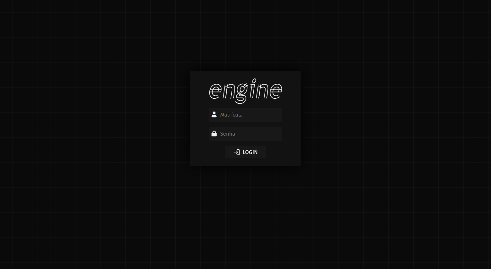
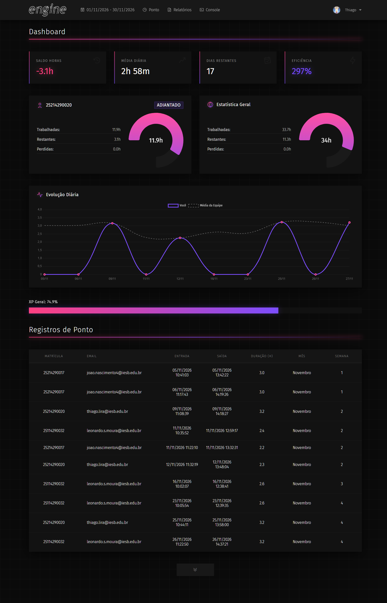
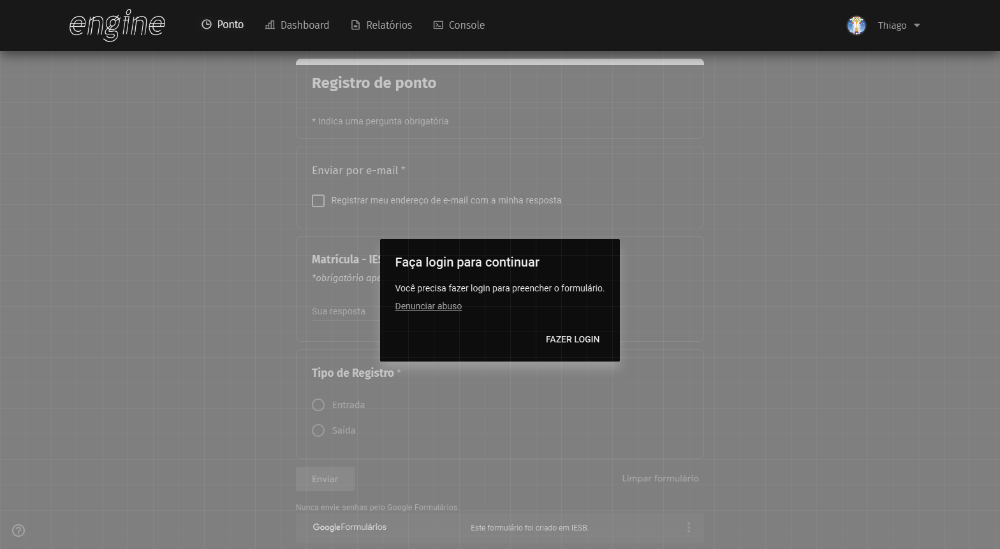
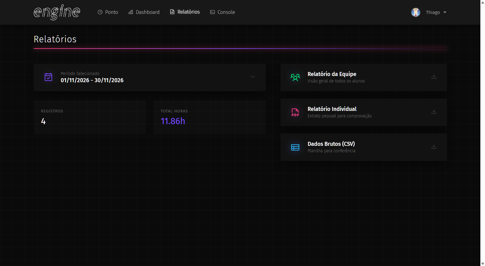
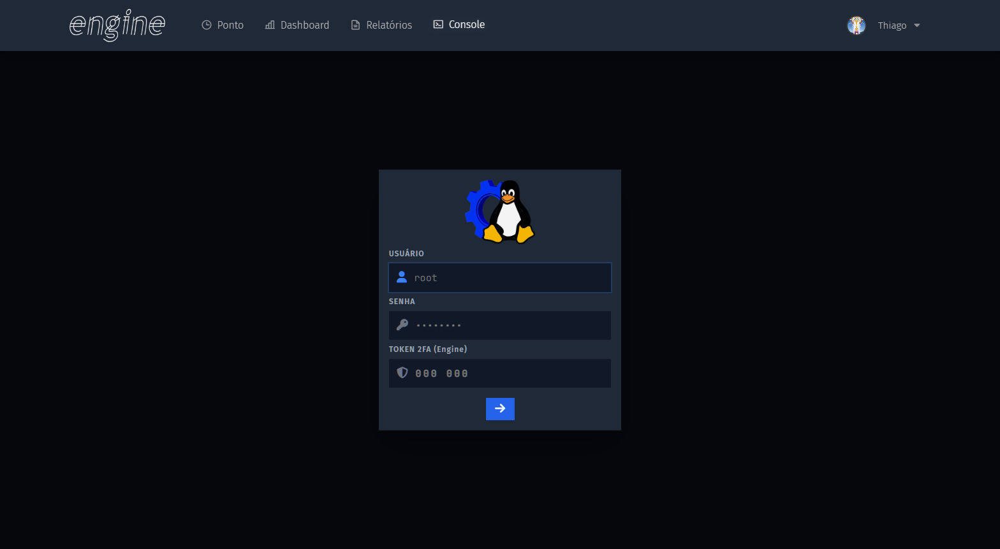

# Engine • Sistema de Ponto e Gestão Operacional

Sistema web de controle de frequência, monitoramento de jornada e administração remota de infraestrutura desenvolvido para a **Oficina de Software e Hardware - Projeto Engine**, projeto de extensão acadêmica do curso de Análise e Desenvolvimento de Sistemas (ADS) no **Centro Universitário IESB Oeste**.

A aplicação opera continuamente em ambiente de produção no domínio [engine.lat](https://engine.lat), provendo à equipe autogestão de carga horária, relatórios consolidados para validação de atividades complementares e ferramentas embutidas de gerenciamento de servidores.

```
+-----------------------------------------------------------------------+
| ARQUITETURA GERAL (engine.lat)                                        |
|                                                                       |
| [ Cliente Web ] ---> [ Nginx (Reverse Proxy / HTTPS) ]                |
|                             |                                         |
|                    [ Node.js / Express Server ]                       |
|                             |                                         |
|         +-------------------+-------------------+                     |
|         |                   |                   |                     |
|  [ Sessões Seguras ]  [ 2FA (TOTP) ]   [ Web Terminal SSH2 ]          |
|  (Bcrypt + Cookies)   (otpauth engine) (Socket.IO + PTY)              |
|         |                   |                   |                     |
|         +-------------------+-------------------+                     |
|                             |                                         |
|                 [ Armazenamento Estruturado ]                         |
|                 (Registros de Ponto e Perfis)                         |
+-----------------------------------------------------------------------+
```

## Contexto e Justificativa do Projeto

O Projeto Engine foi instituído com o propósito de articular teoria e prática mediante o desenvolvimento multidisciplinar de um Arcade físico funcional. As atividades da equipe englobam desde a modelagem de marcenaria e circuitos eletrônicos com Arduino até o desenvolvimento de jogos em Python (Pygame e Curses).

Diante da necessidade de coordenar as atividades dos integrantes, computar com exatidão a carga horária dedicada aos laboratórios e gerar espelhos de ponto auditáveis para a coordenação do IESB, estruturou-se uma plataforma proprietária em servidor Linux dedicado. O sistema substituiu planilhas manuais dispersas por um fluxo contínuo de registro, verificação e emissão de relatórios.

## Funcionalidades e Engenharia de Software

1. **Controle de Ponto e Jornada:** Interface simplificada para marcação de entradas e saídas, cálculo automático de intervalos e cômputo da duração líquida de cada período de atividade.
2. **Dashboard Analítico:** Painel gerencial com consolidação de métricas operacionais, contemplando saldo acumulado de horas, média diária de dedicação, estimativa de dias restantes no período letivo e gráficos de evolução.
3. **Módulo de Relatórios:** Emissão de extratos individuais por matrícula para comprovação de horas complementares, relatórios consolidados de equipe e exportação em formato tabular (CSV).
4. **Console Web e Gerenciamento SSH:** Emulação de terminal remoto segura integrada à interface web por meio das bibliotecas `ssh2` e `socket.io`, viabilizando o monitoramento e manutenção da VPS sem necessidade de clientes de terminal externos.
5. **Autenticação e Segurança:** Criptografia de credenciais com `bcrypt`, sessões assinadas via cookies HTTP-only, proteção contra escalada de privilégios e suporte a autenticação em duas etapas (2FA) baseada em RFC 6238 (TOTP).

## Registros Visuais da Aplicação

### Tela de Autenticação e Acesso Seguro


### Painel Principal e Métricas de Produtividade


### Interface de Registro de Frequência


### Central de Emissão de Relatórios e Auditoria


### Console Administrativo SSH via Navegador


## Estrutura do Repositório

* `server.js`: Ponto de entrada do servidor Node.js/Express, contendo rotas de API, middlewares de autenticação e servidor Socket.IO.
* `add_user.js`: Script utilitário em linha de comando para provisionamento seguro de novos colaboradores com hashing bcrypt.
* `public/`: Interface frontend em HTML5, CSS3 e JavaScript modular (dashboard, terminal, relatórios e formulário de registro).
* `api/`: Módulos de integração externa e barramento de dados.
* `data/`: Diretório de persistência estruturada com modelos de exemplo (`.example.txt` e `.example.json`). Credenciais reais e dados brutos de produção permanecem devidamente ignorados via [.gitignore](.gitignore).
* `docs/screenshots/`: Registros gráficos da interface em operação contínua.

## Execução Local

```bash
# 1. Instalar as dependências do projeto
npm install

# 2. Configurar as variáveis de ambiente
cp .env.example .env

# 3. Inicializar os arquivos de dados locais a partir dos modelos
cp data/usuarios.example.txt data/usuarios.txt
cp data/users.example.json data/users.json
cp data/registros.example.txt data/registros.txt

# 4. Iniciar o servidor de aplicação
npm start
```

O serviço responderá localmente em `http://localhost:3000`.
